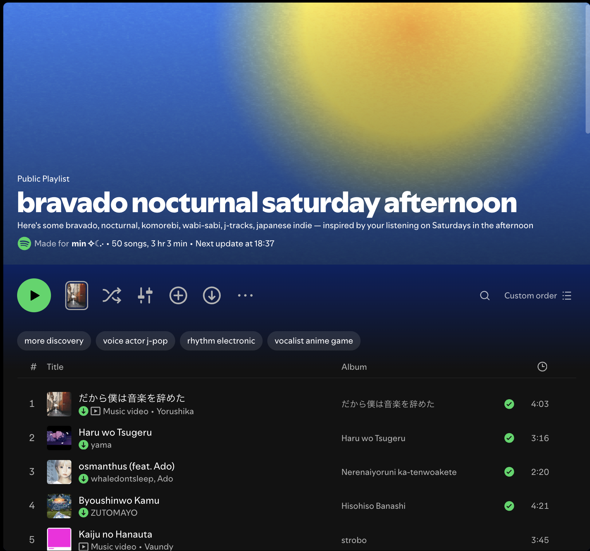

# Birthday Daylist - Songs Personalised for You

## Table of Contents

* [General Info](#general-info)
* [Technologies](#technologies)
* [Setup](#setup)
* [Features](#features)
* [Status](#status)
* [Inspiration](#inspiration)

## General Info
A user-prompted generated playlist in Python, taking inputs of the user's birthday month and current weather, and reading the device's system time to match and elect the correct items for the user.
The songs list is a personalised collection of songs by artists Seventeen and wave to earth, as a personalised factor of my inspiration and motivation for this project.

## Technologies
- Built in PyCharm 2026.2.2
- Python 3.14
  - datetime module
  - json module
- pip 26.0.1

## Setup
To run this program, download the required files in the repository and run the main.py file in PyCharm.

## Features
- A matching algorithm to provide the user with a personalised list of recommended Seventeen and wave to earth songs.
- Over 20 different outcomes of song recommendations.
- Automated system time reading module for optimised experience.

## Status
A beginner Python application project. May potentially be developed further in the future, however at the moment only serves purpose for the project assignment.

## Inspiration
Inspirations include Spotify's automated personalised "daylist" that works based on compiling the time of day with your usual listening habits at the time.

